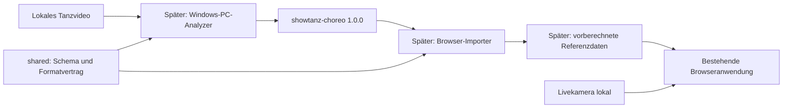

# Showtanztrainer 2.0 – Phase 1

## Ziel und Grenzen

Ein eigenständiger Windows-PC-Analyzer soll später ein Video einmalig lokal
analysieren und ein portables `.choreo`-Paket exportieren. Die Browseranwendung
soll daraus später Referenzposen lesen und nur die Livekamera auswerten.
Phase 1 legt den Vertrag und isolierte Werkzeuge an; sie schaltet keine neuen
Trainingspfade frei. Der aktuelle Nutzerauftrag ist ein separater Formatauftrag
zum älteren Android-Phasenplan; dessen offene Geräteabnahme bleibt bestehen.

Implementiert: `shared/` als gemeinsamer sprachunabhängiger Vertrag;
`analyzer/` als Python-Paket mit Validator und Beispielgenerator;
`tests/test_choreo.py` mit Format-/Sicherheitsregressionen. Es gibt weder eine
Abhängigkeit des Browsers auf Python noch eine neue Cloud-/Backend-Komponente.
Die produktiven Dateien `index.html`, `src/` und `original/` bleiben unverändert.

## Bestandsaufnahme und Integrationspunkte

| Bereich | Bestehender Code | Spätere Anbindung |
| --- | --- | --- |
| Referenzvideo | `src/app.js`: `file.onchange`, Blob-URL, `drawRef`, `seekVideo` | Separater .choreo-Import mit vollständiger Prüfung vor Blob-Freigabe; MP4-Videotimeline erhalten; bisherigen Videoimport als Fallback beibehalten |
| Kamera | `src/camera.js`, Anbindung `cameraController`, `startCameraEffects`, `halt` | Kameradiagnose, Berechtigungen und Stop-Lifecycle erhalten; kein Bezug zum Offline-Analyzer |
| Pose-Erkennung | `detectLandmarks`, PoseLandmarker Lite, IMAGE-Modus, eine Pose | Nur Referenzseite von `tick` und `analyzeRecording` später durch Zeitreihenadapter ersetzen; Livekamera getrennt lassen |
| Musik | `prepareAudio`, `musicVolume`, `createMediaElementSource(ref)` | Eingebetteten Originalton und Offset auf Videotimeline abbilden; Aufnahme-/Playbackrouting berücksichtigen |
| Darstellung | `drawZoomReference`, `liveFrame`, `splitFrame`, `drawRef`; `src/zoom.js` | Paket-Crop bezieht sich auf ganzes Originalbild; vorhandener Autozoom bezieht sich teils auf rechte Hälfte. Explizite Umrechnung erforderlich, nicht ungeprüft übernehmen |
| Bewertung | `descriptors`, `errors`, `similarity`, `suggestions` | Bildkoordinaten aus Originalgeometrie auf Adapter abbilden; fehlende Gelenke propagieren; Bewertung bleibt heuristisch |
| Timing | `tick`, `movementHistory`, `timingEstimate`, `updateTiming` | Zu `ref.currentTime` passende vorberechnete Zeitpunkte finden; Auswahl/Interpolation und große Zeitlücken erst separat spezifizieren/testen |
| Nachanalyse/Aufnahmen | `analyzeRecording`, `startRecording`, `appendFramePair`, MediaRecorder/captureStream | Dieselbe Referenzquelle verwenden; Musik, Spiegelung und Originalzeitbezug regressionsprüfen |

Die bestehende Erkennung lädt `@mediapipe/tasks-vision@0.10.21` von jsDelivr
und das Lite-Modell von Google; dies bleibt unverändert. Bestehende Tests
ersetzen Modelle gezielt, zertifizieren keine reale Erkennungsqualität.
Die aktuelle Weltkoordinaten-/Presence-Ausgabe wird noch nicht persistiert;
der spätere Analyzer muss beide Datenquellen vollständig liefern oder den
betroffenen Punkt explizit als fehlend kennzeichnen.

## GitHub Pages und Deployment

Repositoryprüfung: keine `.github/workflows/`, keine Build-Pipeline. Abfrage
`gh api repos/SaschaPauly/Tanztrainer/pages` am 2026-11-16 bestätigt:
`build_type=legacy`, Quelle `main:/`, Status `built`, HTTPS erzwungen,
https://saschapauly.github.io/Tanztrainer/ . Keine Custom Domain.
Die Konfiguration wird nicht verändert. Neue Werkzeuge sind nicht vom
HTML-Einstiegspunkt referenziert; Pages benötigt weiterhin nur statische
Dateien. Root-Veröffentlichung kann auch neue Dokumente/Fixture-Dateien
öffentlich zugänglich machen; daher enthält das Fixture nur eigene Testdaten.
Vercel-Anleitung im README bleibt gültig: Other, Root `.`, kein Build, Output
`.`. Dieser Auftrag führt weder Deployment noch Merge aus.

## Spätere Integrationsschritte

1. Windows-Analyzer-CLI/GUI separat entwickeln: lokale Decoder-/Codecprüfung,
   Zielpersonauswahl, vollständige MediaPipe-Werte, Sampling auf Originalzeit,
   konservativer Ganzkörperzoom und Qualitätsmeldungen. Keine Uploads.
2. Export transaktional in temporäre Datei schreiben, alle Hashes berechnen,
   Validator ausführen und erst dann fertiges `.choreo` bereitstellen.
3. Browser-Importer im Worker mit begrenztem ZIP-Leser, Schema-/Semantikprüfung,
   SHA-256 und den gemeinsamen Konformitätstests implementieren; mobile Limits
   und Speicherbudget vor Import prüfen. Kein automatisches Ausführen von Inhalt.
4. Zeitreihenadapter für Referenzvideo, Zoomdarstellung und Nachanalyse einführen.
   Keine Referenz-Inferenz bei .choreo-Betrieb; alten Videoimport erhalten.
   Spiegelung und Vergleichsgeometrie explizit regressionsprüfen.
5. Live-Tracking, Timing-/Bewertungsänderungen separat implementieren und mit
   Originaltimeline, variablen Abtastzeiten, fehlenden Daten und Audiooffset
   testen. Erst danach Android-/Windows-Hardware und lange Clips abnehmen.

Installation und Tests: [Analyzer-Anleitung](../analyzer/README.md).
Formatentscheidungen: [FORMAT.md](../shared/FORMAT.md).
Prüfvertrag: [VALIDATION.md](../shared/VALIDATION.md).
